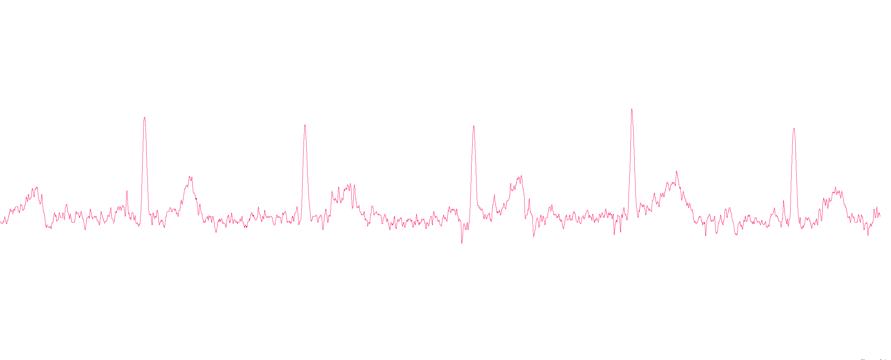
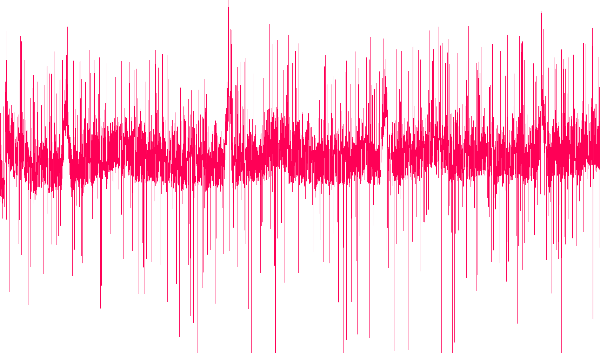
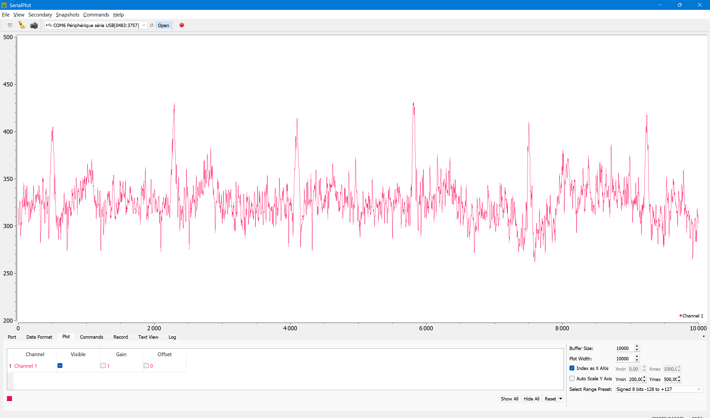
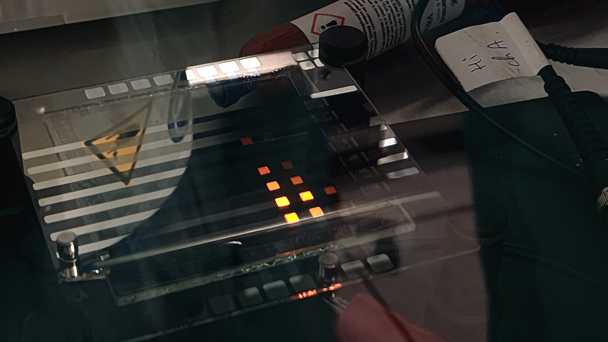
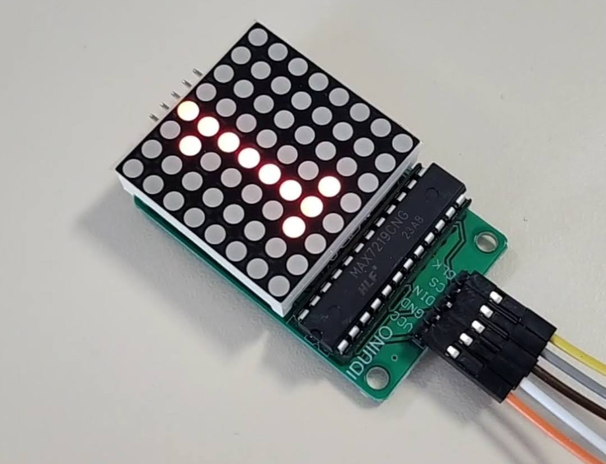
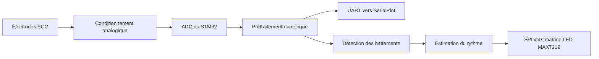

# ECG embarqué sur STM32

**Du signal physiologique bruité à son traitement sur microcontrôleur et à l'affichage du rythme cardiaque.**

Projet réalisé en binôme aux Mines Saint-Étienne, dans le cursus ISMIN, et présenté le **27 mars 2025**. Ce dépôt rassemble le firmware, les résultats expérimentaux et les documents de ce travail pour mon portfolio.

`C embarqué` · `STM32L432KC` · `Traitement du signal` · `ADC / interruptions` · `SPI / UART` · `Microfabrication`

*Signal après traitement présenté dans le rapport de 2025. Les pics cardiaques ressortent de la trace ; cette capture ne constitue pas une mesure de précision clinique.*

## Le projet

Nous avons travaillé sur une chaîne d'acquisition ECG, depuis la fabrication d'électrodes en salle blanche jusqu'au traitement numérique et à la restitution du signal. Le prototype associait une carte de conditionnement analogique, une **NUCLEO-L432KC**, une visualisation sur ordinateur et une matrice LED pilotée par **MAX7219**.

Le principal défi était de rendre un signal fortement bruité suffisamment exploitable pour repérer les battements. Un second défi concernait l'affichage : la matrice OLED fabriquée en salle blanche présentait des fuites de courant et une tension de seuil trop élevée. Le démonstrateur a finalement utilisé une matrice LED du commerce.

## Travail réalisé et compétences mobilisées

Projet de **Paul Guillemin et Tristan Lecourtois**. Le rapport décrit les réalisations du binôme ; la répartition individuelle n'y est pas détaillée. Les éléments ci-dessous présentent donc notre travail collectif.

| Travail réalisé | Compétences mobilisées |
| --- | --- |
| Fabrication et caractérisation d'électrodes et d'une matrice OLED | Photolithographie, dépôt de couches minces, caractérisation en salle blanche |
| Intégration de la chaîne d'acquisition ECG | Conditionnement analogique, mesures à l'oscilloscope, analyse du bruit |
| Programmation du traitement sur STM32 | C, ADC, interruptions, filtrage et extraction d'événements |
| Restitution du résultat | Communication UART, visualisation SerialPlot, pilotage SPI d'une matrice LED |
| Essais et choix d'une solution d'affichage de remplacement | Analyse expérimentale, diagnostic et adaptation aux limites matérielles |

Le pilote de matrice et les bibliothèques STM32 sont des composants tiers réutilisés, identifiés dans les [crédits](THIRD_PARTY_NOTICES.md).

## Résultats du projet

Les documents de 2025 présentent l'acquisition d'un signal ECG, sa visualisation, les étapes de filtrage et le démonstrateur d'affichage. Les captures conservées illustrent les essais successifs ; elles ne proviennent pas nécessairement de la même séquence d'acquisition et ne forment pas un benchmark quantitatif.

| Acquisition bruitée | Signal après prétraitement |
| --- | --- |
|  |  |

Voir les éléments matériels du projet

*Matrice fabriquée en salle blanche : certains pixels s'allument, avec les limitations décrites dans le rapport.*

*Matrice LED avec MAX7219, illustration extraite de la figure 18 du rapport.*

## Architecture

Le firmware conservé enchaîne un traitement des valeurs aberrantes, un passe-bas récursif, une moyenne glissante et une mise au carré. Il contient ensuite une détection par seuil et un calcul d'intervalle entre événements. Le traitement est appelé depuis l'interruption de fin de conversion ADC.

**Le dépôt conserve une version de travail du firmware, recompilée sans modification fonctionnelle.** Certaines descriptions du rapport et certains choix d'implémentation diffèrent : filtre réellement codé, déclenchement de la détection et format série notamment. Ces écarts et les limites numériques sont détaillés dans la [note technique](docs/technical-notes.md).

## Parcourir le dépôt

| Élément | Contenu |
| --- | --- |
| [Firmware STM32CubeIDE](firmware/) | Code C, configuration CubeMX, startup, script de liaison et pilotes requis |
| [Rapport de mars 2025](docs/reports/ecg-report-2025.pdf) | Fabrication, électronique, mesures et démonstrateur |
| [Présentation de mars 2025](docs/reports/ecg-presentation-2025.pdf) | Synthèse du projet présenté en binôme |
| [Guide de reproduction](docs/reproduction.md) | Importation, compilation, brochage logiciel et protocole de vérification |
| [Note technique](docs/technical-notes.md) | Chaîne de traitement conservée et limites de l'archive |
| [Provenance et vérification](docs/validation.md) | Version sélectionnée et contrôles réalisés lors de la préparation du dépôt |

## Reproduire la compilation

1. Ouvrir un espace de travail STM32CubeIDE distinct.
2. Choisir **File → Import → General → Existing Projects into Workspace**.
3. Sélectionner le dossier `firmware/`, puis importer le projet nommé `ECG`.
4. Choisir la configuration **Debug** et lancer **Build Project**.

La compilation a été vérifiée le **19 octobre 2026** avec **STM32CubeIDE 1.19.0** et **GNU Tools for STM32 13.3.rel1** : **0 erreur, 0 avertissement**. Aucun nouveau test sur carte n'a été réalisé à cette occasion.

Les détails du matériel et des essais sont dans le [guide de reproduction](docs/reproduction.md). Ce projet est un prototype pédagogique : il n'est pas présenté comme un dispositif médical validé.

## Limites et suites possibles

- Les images et les essais du rapport témoignent du projet de 2025 ; ils ne valident pas à nouveau le firmware archivé sur matériel.
- La chaîne numérique comporte des points à reprendre avant un usage robuste : gestion de la mise au carré, temporisation de détection et émission série bloquante.
- La matrice OLED fabriquée n'a pas été retenue pour l'affichage final.
- Une évolution pourrait établir un échantillonnage périodique mesuré, sécuriser les calculs et quantifier les performances sur un jeu de signaux de référence. Ces améliorations ne sont pas réalisées dans cette archive.

## Auteurs et contexte

**Paul Guillemin · Tristan Lecourtois** — Mines Saint-Étienne, cursus ISMIN, projet ECG de 2025.

Le projet a été présenté le 27 mars 2025. La préparation de ce dépôt portfolio a commencé le 19 octobre 2026. Les commits d'import sont datés de leur création ; aucun historique de développement passé n'a été inventé.

Les documents et bibliothèques conservent leurs attributions. Aucune licence globale nouvelle n'est attribuée à l'ensemble du dépôt ; consulter les [mentions et crédits](THIRD_PARTY_NOTICES.md).
