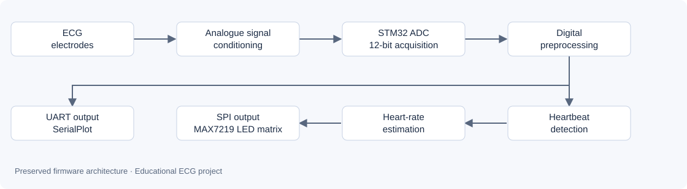

# Embedded ECG Monitor on STM32

**From a noisy physiological signal to on-device processing and heart-rate display.**

A joint project completed at Mines Saint-Étienne as part of the ISMIN engineering programme and presented on **27 March 2025**. This repository brings together the firmware, experimental results and project documents for my portfolio.

`Embedded C` · `STM32L432KC` · `Signal processing` · `ADC / interrupts` · `SPI / UART` · `Microfabrication`

*Processed signal shown in the 2025 report. Cardiac peaks stand out from the trace; this capture is not a measurement of clinical accuracy.*

## The project

We worked on an ECG acquisition chain, from electrode fabrication in a cleanroom to digital processing and signal output. The prototype combined an analogue signal-conditioning board, a **NUCLEO-L432KC**, computer-based visualisation and an LED matrix driven by a **MAX7219**.

The main challenge was to make a heavily noisy signal usable for detecting heartbeats. Display hardware presented another challenge: the OLED matrix fabricated in the cleanroom suffered from current leakage and an excessively high turn-on voltage. The demonstrator ultimately used a commercially available LED matrix.

## My contribution and skills demonstrated

A project by **Paul Guillemin and Tristan Lecourtois**. We worked together on all project tasks. At some stages, we developed two versions and compared the approaches to select the better solution. The work below reflects this joint effort, in which I participated throughout the project.

| Work completed | Skills demonstrated |
| --- | --- |
| Fabricating and characterising electrodes and an OLED matrix | Photolithography, thin-film deposition, cleanroom characterisation |
| Integrating the ECG acquisition chain | Analogue signal conditioning, oscilloscope measurements, noise analysis |
| Implementing processing on STM32 | C, ADC, interrupts, filtering and event detection |
| Presenting the output | UART communication, SerialPlot visualisation, SPI control of an LED matrix |
| Testing and selecting a replacement display | Experimental analysis, troubleshooting and adaptation to hardware limitations |

The matrix driver and STM32 libraries are reused third-party components, identified in the [credits](THIRD_PARTY_NOTICES.md).

## Project results

The 2025 documents describe ECG acquisition, visualisation, filtering stages and the display demonstrator. The preserved captures illustrate successive experiments; they do not necessarily come from the same acquisition sequence and do not constitute a quantitative benchmark.

| Noisy acquisition | Signal after preprocessing |
| --- | --- |
|  |  |

See the project hardware

*Cleanroom-fabricated matrix: some pixels light up, subject to the limitations described in the report.*

*LED matrix with MAX7219, image extracted from Figure 18 of the report.*

## Architecture

The preserved firmware applies outlier processing, a recursive low-pass filter, a moving average and squaring. It then performs threshold-based detection and calculates the interval between events. Processing runs in the ADC conversion-complete interrupt callback.

**This repository preserves a working snapshot of the firmware, rebuilt without functional changes.** Some report descriptions differ from the implementation, particularly the filter, detection trigger and serial output format. These differences and numerical limitations are documented in the [technical notes](docs/technical-notes.md).

## Repository guide

| Item | Contents |
| --- | --- |
| [STM32CubeIDE firmware](firmware/) | C source, CubeMX configuration, startup code, linker script and required drivers |
| [March 2025 report — original French archive](docs/reports/ecg-report-2025.pdf) | Fabrication, electronics, measurements and demonstrator |
| [March 2025 presentation — original French archive](docs/reports/ecg-presentation-2025.pdf) | Summary of the project presented jointly |
| [Reproduction guide](docs/reproduction.md) | Importing, building, firmware pin assignments and verification procedure |
| [Technical notes](docs/technical-notes.md) | Preserved processing chain and archive limitations |
| [Provenance and verification](docs/validation.md) | Selected snapshot and checks performed during repository preparation |

## Reproduce the build

1. Open a separate STM32CubeIDE workspace.
2. Select **File → Import → General → Existing Projects into Workspace**.
3. Select the `firmware/` directory and import the project named `ECG`.
4. Select the **Debug** configuration and run **Build Project**.

The build was verified on **19 October 2026** with **STM32CubeIDE 1.19.0** and **GNU Tools for STM32 13.3.rel1**: **0 errors, 0 warnings**. No new board-level test was performed at that time.

Hardware and test details are provided in the [reproduction guide](docs/reproduction.md). This is an educational prototype, not a validated medical device.

## Limitations and possible next steps

- The report images and experiments document the 2025 project; they do not revalidate the archived firmware on hardware.
- The digital processing chain needs further work before robust reuse: squaring arithmetic, detection timing and blocking serial transmission.
- The fabricated OLED matrix was not used for the final display.
- Future work could establish measured periodic sampling, protect arithmetic operations and quantify performance against reference signals. These improvements are not implemented in this archive.

## Authors and context

**Paul Guillemin · Tristan Lecourtois** — Mines Saint-Étienne, ISMIN engineering programme, 2025 ECG project.

The project was presented on 27 March 2025. Preparation of this portfolio repository began on 19 October 2026. Import commits use their actual creation dates; no past development history has been fabricated.

Original reports, presentation slides, experimental captures and firmware comments are retained as historical source material, including their original language. All portfolio documentation written for this repository is in English.

Documents and libraries retain their original attribution. No new repository-wide licence has been assigned; see the [notices and credits](THIRD_PARTY_NOTICES.md).
